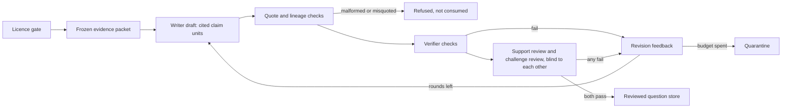

# Question-bank pipeline

The question bank is built inside the medical verifier, not beside it. Package:
`agents/specialists/question_bank/`, next to the verifier's question validation
(`agents/specialists/verification_agent/question_validation.py`), which it calls.

It folds in what held up in the question-bank research
(`research/amboss-uworld` in the qbank worktree: `model/verify_loop.py`,
`model/agent-loop.md`, `model/accuracy-targets.md`, `model/sources.json`,
`docs/quality-workflow.md`) and follows
[§22d](../research/22d-question-bank-brief.md) §4 (validation pipeline) and
§9 (legal risk), narrowed by the verified licence follow-up of October 2026.

| Module | Job |
|---|---|
| `licence_gate.py` | Allowlist (CC0, CC BY), refusal reasons, per-item attribution notice |
| `source_list.py` | The checked source list and the refused register |
| `evidence_loop.py` | Cited claim units, mechanical checks, verifier checks, blind reviews, budget, quarantine |
| `reviewed_store.py` | Export of an accepted item to the reviewed question store |

## Flow

1. **Licence gate.** `initialize` refuses the run, before any file is written,
   if any source fails the gate below. The packet holds only selected
   training-split paragraphs (1 to 30) of gated sources, each with its text hash
   (`citation_integrity.sha256_text`); held-out paragraphs can never be evidence.
2. **Writer draft as cited claim units.** The item is `question`, `answer` and
   `explanation`, each a list of units `{claim_id, text, evidence}`; every
   reference is `{source_id, locator, text_sha256, quote}`. There is no prose
   outside the units.
3. **Mechanical quote and lineage checks** (`evidence_refs`, `validate_item`):
   the reference names a packet paragraph, carries its hash, and quotes it
   exactly. A misquoted or malformed reply is refused and never journaled.
4. **The verifier's deterministic checks** (`deterministic_checks`), before any
   AI review:
   - citation integrity: each quote re-bound as an `EvidenceItem` and checked by
     `verify_citation` against its paragraph (passage found, hashes match);
   - independent entailment: every answer and explanation unit must be
     `SUPPORTS` for at least one of its own quotes and `CONTRADICTS` for none;
   - question validation: `validate_question` on the joined question and
     answer against the answer's cited passages, including its adversarial
     guard; only `VALIDATED` passes.
   A failure becomes revision feedback; no reviewer task is written that round.
5. **Separate support and challenge reviews.** Two tasks with the same item and
   packet, different instructions; neither holds the other review, the writer's
   identity or revision history. Each must judge every unit and every source.
   Writer and reviewers must keep distinct, AI-attributed actor IDs.
6. **Bounded revision.** 1 to 5 rounds (`max_rounds`, default 3). Feedback goes
   to the writer only.
7. **Quarantine.** When the budget is spent the run is `quarantined` and
   writes no further tasks. A quarantined draft is never exported.
8. **Export** (`export_reviewed`): only `accepted_ai_reviewed` runs. The journal,
   hashes, quotes and licences are rechecked, then one record is written to
   `<store>/items/<item_sha256>.json`; a second export of the same item is
   refused.

### File packets, no key, no network

Tasks are `tasks/<role>-<round>.json`; any model or person fills
`replies/<role>-<round>.json`, then `step` consumes it. Replies bind the task
file hash, the packet hash and (for reviews) the item hash, so stale replies
fail. A hash-chained `journal.jsonl` makes the run restart-safe: `audit_run`
rebuilds state from files alone and refuses any changed consumed artifact. The
package imports no HTTP client and reads no key or environment variable; a test
enforces this. The research's network driver (`agent_driver.py`) is not brought.
Actor identities are self-reported, not authenticated.

### Reviewed store record and SOURCE status

Each record is the verifier's own `QuestionArtifact` (`api/schemas/question.py`),
filled per [QUESTION_GENERATION_CONTRACT.md](QUESTION_GENERATION_CONTRACT.md):
source evidence IDs (`<source>#<locator>`), locators, versions, passage and
snapshot hashes, `validation_status` from `validate_question` (`VALIDATED` for
every exported item; `SOURCE_UNCERTAIN`, `SOURCE_UNSUPPORTED`,
`SOURCE_UNAVAILABLE` never export), warnings and supporting source IDs. Beside
it: the claim units, the explanation, the review trail (rounds used,
self-reported actors), the deterministic-check results, licence per parent
source and one attribution notice per parent source. `current_evidence_status`
is `not_checked`: the current-evidence lane is separate and never rewrites the
answer. `requires_human_review` stays true and `clinical_release_allowed` false:
AI review is not clinician adjudication (§22d §4 step 6).

## Three accuracy targets, kept separate

The owner's 99.999% target applies to three endpoints that must never be pooled
(research `model/accuracy-targets.md`). **None is proven.** The loop checks
support within selected licensed paragraphs; matching a quote is not clinical
truth, and two models can share an error.

| Target | Unit | Evidence it needs |
|---|---|---|
| Question validity | The whole item: facts, answerability, single best answer, explanation | Independent clinical adjudication of errors and ambiguity; answer-hidden solving; pilot item statistics (§22d §5) |
| Answer correctness | One answer against a prespecified, expert-adjudicated set of acceptable answers | A fixed question distribution, frozen system, held-out test set, reported abstention |
| Clinical assistance | A complete response in a declared task, population and setting | Appropriateness, completeness, evidence, harm and omission scoring; workflow or prospective evaluation |

With zero observed errors and independent trials, a one-sided 95% lower bound of
99.999% needs 299,572 trials for one endpoint, or 409,433 per endpoint for three
(Bonferroni). Today: zero clinical trials on any endpoint. Model-judge agreement,
exam scores and training loss establish none of the three.

## Licence gate

Only CC0 and CC BY pass. A refused family is refused whatever licence label a
record carries.

| Source or licence | Decision | Reason |
|---|---|---|
| CC0 1.0 | Allowed | Public-domain dedication |
| CC BY 2.0 to 4.0 | Allowed | Attribution: creator, title, link, licence link, changes marked |
| openFDA | Allowed when CC0 and unflagged | CC0 except records flagged otherwise; a flagged record is refused |
| PMC Open Access | Per article | Only an article whose own licence is CC0 or CC BY, with a PMCID and no restrictive notice |
| CC BY-NC (any) | Refused | Non-commercial bars a subscription app |
| CC BY-ND | Refused | No derivatives bars adapting text into questions |
| CC BY-SA | Refused | ShareAlike binds every derived item; refused unless explicitly allowed later |
| OpenStax Anatomy & Physiology 2e | Refused | CC BY-NC-SA 4.0 |
| NICE | Refused | Not CC0/CC BY; own licence |
| WHO | Refused | Not CC0/CC BY |
| MedlinePlus | Refused | Not CC0/CC BY; mixes licensed third-party content |
| StatPearls | Refused | CC BY-NC-ND 4.0 |
| MedMCQA, MedQA, MMLU | Refused | Licence unclear or exam-derived; screening only |
| UNKNOWN or missing | Refused | No readable licence |

The checked source list (`source_list.ALLOWED_SOURCES`) is the research's three
PMC CC BY 4.0 articles; PMC11893709 is held out (validation split). Authors and
the article's licence notice come from ingestion: the gate refuses a CC BY source
whose attribution is still missing. `attribution_notice` builds the per-item
notice stored with every exported question.

## Left out, and why

- **The Rust core** (`src/lib.rs`, `src/authoring.rs`, `src/analytics.rs`) is a
  reference only. Stethoscore is an iOS app with a Worker; the Rust crate is not
  a runtime here. Its release-gate idea (status derived from current evidence,
  reviews bound to a content digest) is what the hash-bound journal keeps.
- **Gap list for the iOS app**, from the Rust core's learner features:
  1. folders (custom question sets);
  2. filter presets (topic, difficulty, unused / incorrect / omitted / marked);
  3. help tracking (a hint or reveal marks the attempt as helped);
  4. study mode (feedback after each item) and exam mode (timed, feedback at end,
     pause and resume);
  5. first-attempt analytics (only unaided, consented first attempts count
     toward item statistics).
- **The network driver** (`agent_driver.py`) and any provider endpoint: the
  module must work with file packets alone.
- **Clinical release.** Nothing in this pipeline releases an item clinically.

## Model training

Training is not excluded. The owner wants the question-bank model trained, with
no size ceiling; that work lives in the Claude-Code research lane with its Colab
loop, not in this repository. What training may later draw from is the reviewed
store, never raw sources, and only items whose review state allows it, after
review. Held-out paragraphs stay out of writer packets and out of the store, so
evaluation sets stay clean.

## Tests

`tests/unit/test_question_bank_loop.py`: success with blind reviews; revision
then quarantine at the bound; verifier checks blocking AI review; missing,
duplicate and stale reviews; a misquoted unit refused and not journaled; broken
references; held-out evidence; per-source review; actor separation; non-CC-BY
sources refused before a run starts; every refused family; openFDA and PMC
rules; restart from files and tamper refusal; export with provenance and
attribution; quarantined export refused; no network or key in the package.
All fixtures are fabricated software data, not clinical labels.
